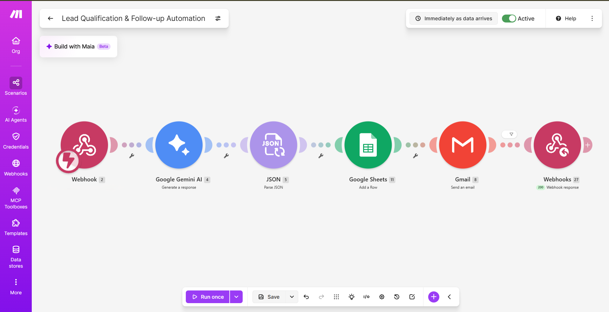
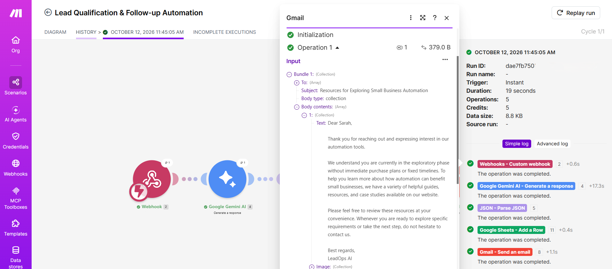

# LeadOps AI 🚀

AI-powered lead qualification and follow-up automation using **Google Gemini, Make.com, Google Sheets, JavaScript, and Vercel**.

LeadOps AI captures incoming leads, analyzes their buying intent and requirements using Gemini, assigns a priority level, stores the result in Google Sheets, and automatically sends personalized follow-up emails to qualified leads.

---

## ⚙️ Make.com Workflow Architecture



## ✅ Successful Automation Execution



## ✨ How It Works

```text
Lead Form (Browser)
   ↓
Vercel API Proxy (/api/lead)
   ↓ (MAKE_WEBHOOK_URL)
Make.com Webhook
   ↓
Google Gemini AI Engine
   ↓
Lead Qualification & Priority Scoring
   ↓
JSON Response Parsing
   ↓
Google Sheets Logging
   ↓
Conditional Follow-up Email
   ↓
Webhook Response → Frontend Feedback
```

---

## 🧠 Lead Qualification Matrix

Gemini evaluates the lead based on:
- Buying intent
- Requirement specificity
- Urgency
- Business context
- Active vendor/solution evaluation

| Priority  | Description                                      | Action     |
| --------- | ------------------------------------------------ | ---------- |
| 🔴 **HIGH**   | Strong intent, clear requirement, or urgent need | Email sent |
| 🟡 **MEDIUM** | Genuine interest but lower urgency               | Email sent |
| ⚪ **LOW**     | General inquiry or weak buying intent            | Email sent |

---

## 🛠️ Tech Stack

- **Frontend**: HTML5, CSS3, Modern JavaScript
- **Backend API**: Vercel Serverless Functions (`/api/lead`)
- **AI Model**: Google Gemini
- **Automation Engine**: Make.com
- **Database / CRM**: Google Sheets
- **Email Delivery**: Make.com Email Module
- **Deployment Platform**: Vercel

---

## 📁 Project Structure

```text
leadops-ai/
├── api/
│   └── lead.js            # Vercel Serverless API function (Webhook Proxy)
├── assets/
│   └── logo2.png          # LeadOps AI brand logo
├── index.html             # Main web application UI
├── styles.css             # Glassmorphic UI styling system
├── app.js                 # Frontend application logic & validation
├── config.example.js      # Template configuration file
├── package.json           # Project metadata & Vercel configuration
└── README.md              # Documentation
```

---

## 🚀 Vercel Deployment & Environment Variables

### 1. Deploying to Vercel
Push the repository to GitHub and connect it to Vercel, or deploy using the Vercel CLI:

```bash
npx vercel
```

### 2. Environment Variables
To keep your Make.com Webhook URL secure and hidden from the browser, set the environment variable in Vercel:

- **Key**: `MAKE_WEBHOOK_URL`
- **Value**: `https://hook.eu2.make.com/your-actual-webhook-id`

---

## ⚙️ Local Setup

1. Clone the repository:
   ```bash
   git clone https://github.com/SakshiDethe03/LeadOps-AI.git
   cd LeadOps-AI
   ```

2. Copy `config.example.js` to `config.js` and add your webhook URL for standalone local testing:
   ```javascript
   const CONFIG = {
       MAKE_WEBHOOK_URL: "YOUR_MAKE_WEBHOOK_URL",
       DEMO_MODE: false,
       TIMEOUT_MS: 20000
   };
   ```

3. Launch with Vercel CLI (`npx vercel dev`) or serve `index.html`.

---

## 🎯 What This Project Demonstrates

LeadOps AI demonstrates an end-to-end AI automation pipeline where Generative AI output directly drives business actions such as lead prioritization, data logging, and conditional follow-up with enterprise-grade security and serverless deployment.

---

## 👩‍💻 Author

**Sakshi Satish Dethe**  
AI & Automation Developer
